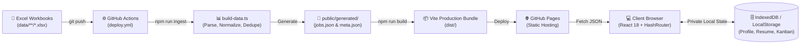

<h1 align="center" style="font-size: 2.8rem; margin-bottom: 0;">
  📡 RoleRadar
</h1>

<div align="center">

[](https://react.dev/)
[](https://www.typescriptlang.org/)
[](https://vitejs.dev/)
[](https://tailwindcss.com/)
[](https://github.com/features/actions)
[](https://developer.mozilla.org/en-US/docs/Web/API/IndexedDB_API)
[](LICENSE)

**A high-performance, personal career workspace and job intelligence portal hosted 100% statically on GitHub Pages.**

</div>

---

> [!NOTE]
> ### 💫 Fully Vibe-Coded Project
> **RoleRadar is a fully vibe-coded application.** Built collaboratively through rapid AI pair programming, this project was brought to life using **ChatGPT**, **Claude**, and the true saviour and companion, **Google Antigravity**.

---

## ⚡ Highlights & Core Features

```
┌─────────────────────────────────────────────────────────────────────────────┐
│ 🌟 Golden Matches (≥ 80%)    │ 📄 Client-Side CMap PDF Parser (Zero Server)│
│ 🎯 Time-Adaptive Greetings   │ 💼 Local IndexedDB Application Kanban       │
│ 🔎 Themed Multi-Axis Filters │ 🚀 Continuous Excel GitOps via Actions      │
└─────────────────────────────────────────────────────────────────────────────┘
```

### 1. 🌟 Golden Opportunity Radar & Skill Matching
- **Strict Matching Standards**:
  - 🏆 **Golden Opportunity (`≥ 80%` fit)**: Highlights high-conviction matches with glowing amber outlines (`#F5B700`). Requires experience compatibility, title relevance, and at least 2 key overlapping skills.
  - 🟢 **Potential Match (`50% – 79%` fit)**: Highlights solid opportunities with glowing emerald borders (`#10B981`).
  - ⚪ **Below 50%**: Filtered out cleanly to eliminate noise.
- **One-Click Cold Pitch Generator**: Instantly composes a professional, personalized recruiter outreach message quoting your top matching skills and target position.

### 2. 📄 Zero-Server Client-Side Resume Engine
- **In-Browser Decompression**: Decompresses binary PDF streams using native browser `DecompressionStream` and a synchronous, pure JavaScript DEFLATE/zlib inflator (`inflateRaw`).
- **ToUnicode CMap Decoder**: Parses modern CID hex fonts (`[<0026...>-247<...>] TJ`) produced by Overleaf, LaTeX, and Canva.
- **Smart Extraction**: Auto-detects candidate name, target role headline, experience level (Fresher / Years), and 25+ technical skills directly in your browser.
- **100% Offline & Private**: Your resume never leaves your computer. No external APIs, no cloud storage, no token costs.

### 3. 🌙 Dynamic Motivational Greetings
- Tailors greetings to your exact local time:
  - **Late Night (`00:00 – 05:00`)**: *"Welcome back, nightowlers! · Burning the midnight oil pays off."*
  - **Dawn (`05:00 – 09:00`)**: *"Good early morning! · The early bird catches the best roles."*
  - **Morning, Afternoon & Evening**: Uplifting, purpose-built motivational quotes.

### 4. 🎛️ High-Contrast Custom Dropdown Filters
- Designed specifically for dark and light modes without native Windows `<select>` rendering bugs.
- **6 Multi-Axis Filters**:
  1. **Department**: Engineering, Security, QA, Data, Design, Product, etc.
  2. **Experience (Years)**: Dedicated brackets (`0-1 yrs Fresher/Intern`, `1-3 yrs Junior`, `3-5 yrs Mid`, `5-8 yrs Senior`, `8+ yrs Lead`) + exact year filters.
  3. **Seniority**: Fresher / Junior, Mid-level, Senior, Lead.
  4. **Work Mode**: Remote, Hybrid, Onsite.
  5. **Market / Region**: India, US, Europe, Global.
  6. **Sorting**: Date posted, seniority, relevance.

### 5. 💼 Private Application Pipeline & Bookmarks
- **Local Kanban Board**: Track applications through `Saved` ➔ `Applied` ➔ `Interviewing` ➔ `Offered` ➔ `Rejected`.
- **IndexedDB Storage**: Bookmarks, resumes, notes, and statuses persist across browser refreshes in IndexedDB.
- **Data Portability**: Full JSON backup export and restore built into Settings.

---

## 🏗️ Architecture & Data Pipeline

RoleRadar turns your repository into a self-updating, serverless job portal using a GitOps-driven pipeline:



---

## 📁 Repository Structure

```text
roleradar/
├── .github/
│   └── workflows/
│       └── deploy.yml           # Automated CI/CD pipeline for GitHub Pages
├── data/                        # Drop new Excel sheets here!
│   └── 2026/
│       └── november/
│           └── KrishnaAITech_Job_Sheet_2026-11-02.xlsx
├── public/
│   ├── favicon.svg              # RoleRadar Radar Logo
│   └── generated/               # Auto-generated by build pipeline
│       ├── jobs.json            # Unified normalized jobs dataset
│       └── meta.json            # Ingestion metadata & worksheet stats
├── scripts/
│   └── build-data.ts            # High-speed multi-sheet Excel processor
├── src/
│   ├── db/
│   │   └── local.ts             # IndexedDB & LocalStorage client DB
│   ├── types/
│   │   └── job.ts               # Strict TypeScript definitions
│   ├── utils/
│   │   ├── format.ts            # Pretty dates, badges, compact numbers
│   │   ├── inflate.ts           # Pure JS DEFLATE / zlib stream decompressor
│   │   └── matcher.ts           # Resume parser, CMap decoder & match engine
│   ├── App.tsx                  # Main single-page application & routing
│   ├── index.html               # HTML entry point with meta tags
│   ├── main.tsx                 # React DOM bootstrapper (HashRouter)
│   ├── styles.css               # Core layout, glowing borders & responsive CSS
│   └── theme.css                # Dark/light theme design system
├── package.json
├── tsconfig.json
└── vite.config.ts               # Automatic base-path handling for GitHub Pages
```

---

## 🚀 Step-by-Step Deployment Guide (GitHub Pages)

### Step 1: Create a GitHub Repository
1. Log in to [GitHub](https://github.com/).
2. Click **New Repository** (top right).
3. Name your repository (e.g., `roleradar` or `job-intelligence`).
4. Set the visibility to **Public** *(required for free GitHub Pages)*.
5. Do **not** initialize with a README (this repository already has one).
6. Click **Create repository**.

### Step 2: Push Your Code to GitHub
Open your terminal in this project folder and run:

```bash
# 1. Initialize git (if not already initialized)
git init

# 2. Add all files
git add .

# 3. Create initial commit
git commit -m "feat: launch RoleRadar intelligent career workspace"

# 4. Set default branch to main
git branch -M main

# 5. Connect your remote repository (replace with your URL)
git remote add origin https://github.com/YOUR_USERNAME/roleradar.git

# 6. Push to GitHub
git push -u origin main
```

### Step 3: Enable GitHub Actions for Pages
1. Go to your repository on GitHub.
2. Click **Settings** (tab at the top).
3. In the left sidebar, click **Pages** (under "Code and automation").
4. Under **Build and deployment**:
   - Change **Source** from *Deploy from a branch* to **GitHub Actions**.
5. That's it!

### Step 4: Watch It Deploy
1. Click the **Actions** tab in your GitHub repository.
2. You will see a workflow named **`Build and deploy RoleRadar`** running automatically.
3. Once completed (takes ~45 seconds), your live site URL will be displayed at the top:
   ```
   https://YOUR_USERNAME.github.io/roleradar/
   ```

---

## 🔄 Automatic Data Reload: How Adding New Jobs Works

Whenever you receive a new Excel job sheet, you **do not** need to edit any code or configure databases:

```bash
# 1. Place the new .xlsx file anywhere under data/
cp new_jobs.xlsx data/2026/november/new_jobs.xlsx

# 2. Commit and push
git add data/
git commit -m "data: add latest job sheet"
git push
```

### What Happens Behind the Scenes:
1. **Trigger**: GitHub Actions detects changes in `data/**` via [`.github/workflows/deploy.yml`](.github/workflows/deploy.yml).
2. **Ingest**: The pipeline runs `npm run ingest` (`scripts/build-data.ts`).
3. **Parse & Normalize**:
   - Discovers all nested workbooks.
   - Parses each worksheet (ignoring summary sheets).
   - Maps column aliases (`title`, `company`, `experience`, `skills`, `applyUrl`, etc.).
   - Extracts hyperlinked formulas to capture raw application URLs.
   - Deduplicates identical postings using SHA-1 fingerprints.
4. **Build & Publish**: Vite compiles the updated `jobs.json` into static assets and publishes the updated portal live to GitHub Pages.
5. **Zero Downtime**: Visitors refresh the page and instantly see the new jobs, count badges, and match scores.

> [!TIP]
> You can also trigger an immediate rebuild at any time manually by going to **Actions** ➔ **Build and deploy RoleRadar** ➔ **Run workflow**.

---

## 💻 Local Development

### Prerequisites
- [Node.js](https://nodejs.org/) v20 or v22+
- npm or pnpm

### Setup Commands
```bash
# Install dependencies
npm install

# Start local development server with hot-reload
npm run dev

# Regenerate dataset from Excel files in data/
npm run ingest

# Build and preview production release locally
npm run build
npm run preview
```

---

## 🔒 Privacy & Security

- **Public Repository Notice**: Since this repository is public, any Excel sheets committed under `data/` and generated job files are public. Do not commit confidential compensation letters, private emails, or private company data.
- **Client-Side Isolation**: All candidate information—including your resume file, parsed skills, application notes, interview dates, and bookmarked jobs—is stored exclusively inside your browser's private **IndexedDB** / **LocalStorage**. Nothing is sent to an external server.

---

## 🤝 Acknowledgements & Credits

- **Crafted with AI**: Proudly vibe-coded through continuous prompt-driven iteration using **ChatGPT**, **Claude**, and **Google Antigravity**.
- **Libraries & Icons**: Powered by [React](https://react.dev/), [Vite](https://vitejs.dev/), [Lucide React](https://lucide.dev/), [SheetJS (xlsx)](https://sheetjs.com/), [Recharts](https://recharts.org/), and [TanStack Table](https://tanstack.com/table).

---

<div align="center">
  <sub>RoleRadar · Built for ambitious careers · Free & Open Source under the MIT License</sub>
</div>
