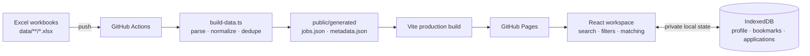

<div align="center">

# 📡 RoleRadar

### Career intelligence for your next move

RoleRadar is a privacy-first job discovery workspace that turns a large job dataset into a focused, searchable and personalized career dashboard.

[](https://tech9ic.github.io/RoleRadar/)
[](https://react.dev/)
[](https://www.typescriptlang.org/)
[](https://vitejs.dev/)
[](https://tailwindcss.com/)

<br />

**[Open the live workspace →](https://tech9ic.github.io/RoleRadar/)**

</div>

---

## What is RoleRadar?

Job boards are good at showing more listings. RoleRadar is built to help you find the **right** listings faster.

Upload your resume or configure your profile, explore normalized job data, and let the browser calculate which roles deserve your attention. Save promising roles, track your applications, and keep your career search organized without sending personal data to a backend.

> **Designed for clarity. Built for privacy. Made for momentum.**

## ✨ The experience

### A landing page that gets you moving

Start with a focused search, browse trending skills, jump straight to fresher roles, or launch the full workspace. Light and dark themes, responsive layouts, and purposeful visual hierarchy keep the experience useful on both desktop and mobile.

### A workspace instead of another job list

The application is organized around the way a real job search works:

| Surface | What you can do |
| --- | --- |
| **Dashboard** | See dataset health, match totals, recent roles and your current career-search snapshot |
| **Explore Jobs** | Search across title, company, location, department, skills and more |
| **Fresher Jobs** | Quickly isolate entry-level, graduate, intern and junior opportunities |
| **Departments** | Browse roles by career area and understand the distribution of the dataset |
| **My Profile & Resume** | Store your target role, experience, skills and parsed resume details |
| **Bookmarks** | Keep a focused shortlist of roles worth revisiting |
| **Applications** | Track roles from interested and saved through assessment, interview, offer or rejection |
| **Analytics** | Understand job volume, locations, work arrangements and hiring patterns |
| **Data Sources** | Inspect the workbooks and ingestion metadata behind the job database |
| **Settings** | Switch themes and export or restore your local RoleRadar backup |

## 🎯 Match Radar

RoleRadar calculates a transparent match score in the browser using your profile and each job's structured data.

- **🏆 Golden opportunity — 80%+**: strong alignment across experience, title relevance and at least two key skills.
- **🟢 Potential match — 50–79%**: a promising role with meaningful overlap.
- **⚪ Below 50%**: kept out of the focused match view so the signal stays useful.

Match explanations surface the overlapping skills and relevant experience instead of hiding the result behind an opaque recommendation. When a role looks right, the built-in cold-pitch generator can draft a personalized recruiter message using the role and your matching strengths.

## 📄 Resume intelligence, entirely in your browser

RoleRadar can extract useful profile signals from a resume PDF without uploading the file:

- Decompresses PDF streams with native browser APIs and a pure JavaScript fallback.
- Decodes ToUnicode CMaps used by modern CID fonts.
- Detects a candidate name, target role, experience level and technical skills.
- Maps related terms through a canonical skill and synonym dictionary.
- Recalculates job matches as your profile changes.

Your resume text, profile, bookmarks, notes and application history stay in your browser. There is no resume API, hosted database or paid AI key hidden behind the experience.

## 🔖 A private application command center

Save roles directly from the job browser and move them through a practical pipeline:

```text
Interested → Saved → Applied → Assessment → Interview → Offer
                                                        ↘ Rejected
```

Add follow-up dates and notes, then export everything as a `roleradar-backup.json` file whenever you want a portable copy of your local workspace.

## 🏗️ How the data pipeline works

Job data starts as Excel workbooks and becomes a searchable static dataset during the build:



The ingestion script:

1. Discovers nested `.xlsx` files under `data/`.
2. Skips summary sheets and recognizes common column aliases.
3. Extracts application links, normalizes fields and combines duplicate records.
4. Generates jobs, metadata, an ingestion report and a manifest.
5. Publishes the updated static site through GitHub Pages.

Adding a new job sheet is intentionally simple:

```bash
Copy-Item .\new_jobs.xlsx .\data\2026\november\
git add data
git commit -m "data: add latest job sheet"
git push
```

The workflow runs automatically when `data/`, application source, scripts or build configuration changes. You can also trigger it manually from **Actions → Build and deploy RoleRadar → Run workflow**.

## 🧰 Tech stack

| Layer | Technology |
| --- | --- |
| UI | React 18, React Router, TypeScript |
| Build | Vite, Tailwind CSS, PostCSS |
| Data | SheetJS, generated JSON, GitHub Actions |
| Local persistence | IndexedDB via `idb`, with LocalStorage preferences |
| Search | Fuse.js fuzzy search |
| Visualizations | Recharts |
| Icons and typography | Lucide React, Bricolage Grotesque, Instrument Sans |
| Hosting | GitHub Pages |

## 📁 Repository map

```text
roleradar/
├── .github/workflows/deploy.yml  # Type-check, ingest, build and deploy
├── data/                         # Source Excel workbooks
├── public/
│   ├── favicon.svg
│   └── generated/                # Build-generated job data and reports
├── scripts/build-data.ts         # Excel ingestion and normalization
├── src/
│   ├── db/local.ts               # IndexedDB and local backup helpers
│   ├── types/job.ts              # Shared domain types
│   ├── utils/
│   │   ├── matcher.ts            # Resume parsing and match scoring
│   │   ├── inflate.ts            # Pure JavaScript PDF decompression
│   │   └── format.ts             # Display formatting helpers
│   ├── App.tsx                   # Workspace routes and application state
│   ├── LandingPage.tsx           # Public landing experience
│   ├── styles.css                # Layout and component styling
│   └── theme.css                # Light and dark design tokens
├── package.json
├── tsconfig.json
└── vite.config.ts
```

## 🚀 Run it locally

### Prerequisites

- Node.js 20 or newer
- npm

### Setup

```bash
git clone https://github.com/tech9ic/RoleRadar.git
cd RoleRadar
npm install
```

### Development commands

```bash
npm run dev        # Start Vite with hot reload
npm run ingest     # Rebuild generated data from Excel workbooks
npm run typecheck  # Run the TypeScript project check
npm run lint       # Run ESLint
npm run build      # Ingest, type-check and create a production build
npm run preview    # Preview the production build locally
```

Open the local URL printed by Vite, usually `http://localhost:5173`.

## 🌐 Deploy to GitHub Pages

1. Fork or clone the repository.
2. Push it to a public GitHub repository.
3. In **Settings → Pages**, set the source to **GitHub Actions**.
4. Push a change to `main`, or run **Build and deploy RoleRadar** manually from the Actions tab.

The workflow uses Node 22, runs the type-check, ingests the Excel dataset, builds the Vite app and deploys `dist/` to GitHub Pages. Vite automatically derives the correct repository base path in GitHub Actions.

## 🔒 Privacy and data boundaries

RoleRadar is static by design:

- Resume parsing and match scoring happen locally in the browser.
- Profile data, bookmarks and applications use IndexedDB / LocalStorage.
- No personal profile or resume data is sent to a RoleRadar server.
- Public Excel files and generated job data are visible in the repository and deployed site.
- Never commit confidential resumes, compensation letters, private emails or internal company data to `data/`.

## 🤝 Contributing

Ideas, bug reports and improvements are welcome. Before opening a pull request:

```bash
npm run typecheck
npm run lint
npm run build
```

For data changes, add or update the relevant workbook under `data/` and verify the generated dataset locally with `npm run ingest`.

## 🌟 Credits

RoleRadar is an open-source, AI-assisted project built through rapid human–AI pair programming. It is powered by React, Vite, TypeScript, SheetJS, Fuse.js, Recharts, TanStack Table and Lucide.

<div align="center">
  <br />
  <sub>RoleRadar · Built for ambitious careers</sub>
</div>
